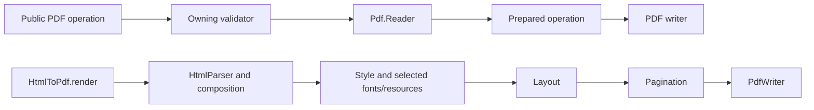

# Project architecture

This library has public PDF operations, shared PDF readers and writers, an HTML
rendering pipeline, and validators that own input and semantic rules.

See [Contributing](../../CONTRIBUTING.md) for setup and the contribution workflow.

## Source layout

| Location | Responsibility |
| --- | --- |
| `lib/*.ex` | Public operations such as `Merge`, `Forms`, `Text`, `Tokenizer` and `HtmlToPdf`, plus application setup, diagnostics, file reading and limits |
| `lib/pdf/` | PDF object reading, encoding, object remapping and operation-specific writers |
| `lib/html_to_pdf/` | HTML/CSS parsing, composition, fonts, images, layout, pagination and PDF paint |
| `lib/validators/` | Input, option, document, resource and semantic validation |
| `priv/fonts/`, `priv/licenses/` | Bundled font/data inputs and their licenses |
| `test/` | Tests grouped by API, implementation area and feature |
| `scripts/` | Quality checks, benchmarks, example builders and reproducible data/fixture generators |
| `dev/manual_web/` | A separate Mix application for manually exercising the library |
| `docs/` | User guides, examples and supported behavior |
| `docs/contributing/` | Maintained contributor architecture, testing and script guides |
| `tmp/development/` | Ignored local plans, investigations, audits and work records |

An Elixir source path follows its module after the `NativeElixirPdfUtilities`
prefix. `NativeElixirPdfUtilities.Merge` lives in `lib/merge.ex`;
`NativeElixirPdfUtilities.HtmlToPdf.Layout` lives in
`lib/html_to_pdf/layout.ex`. Public module names and function signatures are
independent of how tests and fixtures are grouped.

## Execution paths

Each HTML stage delegates its admission rules to the appropriate validator.
Validators produce the canonical values consumed downstream. Keep a rule in one
validator rather than repeating it in a parser, public facade or execution module.
The PDF reader supplies one object model to merging, transforms, text, forms,
attachments, metadata and outlines.

`ResourceContext` carries document/resource authority through HTML composition
and embedded viewports. Fonts, images and caches retain that scope. A test that
needs an issued context creates it through the public preparation path.
`Diagnostics` owns recoverable failure maps and `Limits` owns configurable
resource ceilings.

## Tests and fixtures

See [test organization](testing.md). API tests exercise caller-visible
behavior. Feature tests cover the relevant parser, style, layout, writer or
validator. Integration tests cover interactions among those owners.

Browser comparisons use named source fixtures and the shared Chromium helper.
The browser corpus retains one resource directory so relative authored URLs and
resource authorization keep the same meaning. Its descriptive filenames identify
the feature and scenario. Larger document examples and JPEG inputs have separate
fixture directories.

## Maintained files and local artifacts

Feature names belong in maintained source, test and fixture paths. Work sequence
numbers and temporary audit labels belong in local work records.
For example, use `atomic_table_hidden_overflow.html` and
`atomic_table_overflow_test.exs`.

Generated library data belongs in its owning module and records its generator
under `scripts/data/`. Checked-in reference fixtures record their generators
under `scripts/fixtures/`. Generated examples live under `docs/assets/`.
Keep reusable contributor guidance in `docs/contributing/`. Plans, work records,
audits and experimental outputs go under ignored `tmp/`; validation logs and runtime caches
go under ignored `.quality/`.

The quality matrix cleans the application build for each isolated runtime before
compiling. It reuses dependency and tool caches while rebuilding application
modules from the current source.

Large owners such as `Layout`, `Style` and `HtmlValidator` still contain several
related features. Extract a component when it has a clear responsibility and
contract, rather than creating files named after a development batch or adding
another general-purpose helper module.
