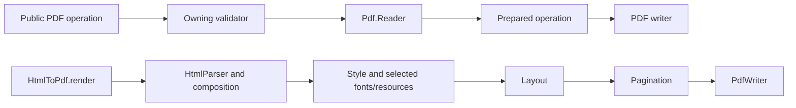

# Project architecture

See [Contributing](../../CONTRIBUTING.md) for setup and [testing](testing.md) for checks.

## Source layout

| Location | Owns |
| --- | --- |
| `lib/*.ex` | Public APIs, application setup, diagnostics, file reading and limits |
| `lib/pdf/` | PDF reading, encoding, object remapping and operation-specific writers |
| `lib/html_to_pdf/` | HTML/CSS parsing, composition, fonts, images, layout, pagination and painting |
| `lib/validators/` | Input, option, document, resource and semantic validation |
| `priv/fonts/`, `priv/licenses/` | Bundled fonts/data and licenses |
| `test/` | API, feature and integration tests; see [test organization](testing.md#test-organization) |
| `scripts/` | Checks, benchmarks and generators; see [scripts](scripts.md) |
| `dev/manual_web/` | Separate development application |
| `docs/`, `docs/contributing/` | User guides and public contributor guidance |

Paths follow the module after `NativeElixirPdfUtilities`:

| Module | File |
| --- | --- |
| `NativeElixirPdfUtilities.Merge` | `lib/merge.ex` |
| `NativeElixirPdfUtilities.HtmlToPdf.Layout` | `lib/html_to_pdf/layout.ex` |

## Execution paths

| Owner | Rule |
| --- | --- |
| Validators | Own validation rules; downstream code uses validated results without duplicating checks |
| `Pdf.Reader` | Shared object model for PDF operations |
| `ResourceContext` | Preserve resource permissions through composition, child viewports, images, fonts and caches; tests use public preparation |
| `Diagnostics` | Shared recoverable failure maps |
| `Limits` | All configurable resource ceilings |

Extract components when they have a clear responsibility and contract.

## Tests and fixtures

| Test type | Checks |
| --- | --- |
| API | Caller-visible behavior |
| Feature | Its parser, style, layout, writer or validator |
| Integration | Interactions between features |
| Browser parity | Chromium comparisons using the shared helper and authored fixtures |

See [shared paths and fixtures](testing.md#shared-paths-and-fixtures) for locations and resource-base rules.

## Maintained files and local artifacts

| Content | Location or naming |
| --- | --- |
| Source, tests, fixtures, tags and artifacts | Feature/scenario names, such as `atomic_table_hidden_overflow.html`; no batch numbers or audit labels |
| Generated library data | Owning module; generator and provenance under `scripts/data/` |
| Reference fixtures | Feature directories under `fixtures/`; generators under `scripts/fixtures/` |
| Generated examples | `docs/assets/` |
| Plans, investigations and experiments | Ignored `tmp/`, preferably `tmp/development/` |
| Validation logs and runtime caches | Ignored `.quality/`; see [matrix isolation](testing.md#full-quality-matrix) |
