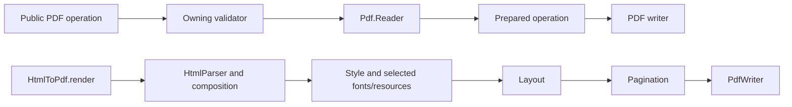

# Project architecture

See [Contributing](../../CONTRIBUTING.md) for setup and [testing](testing.md) for checks.

## Source layout

| Location | Owns |
| --- | --- |
| `lib/*.ex` | Public APIs, application setup, diagnostics, file reading and limits |
| `lib/pdf/` | PDF reading, encoding, object remapping and operation-specific writers |
| `lib/html_to_pdf/` | HTML/CSS parsing, composition, fonts, images, layout, pagination and painting |
| `lib/validators/` | Input, option, document, resource and semantic validation |
| `priv/fonts/`, `priv/licenses/` | Bundled fonts/data and licenses |
| `test/` | API, feature and integration tests; see [test organization](testing.md#test-organization) |
| `scripts/` | Checks, benchmarks and generators; see [scripts](scripts.md) |
| `dev/manual_web/` | Separate development application |
| `docs/`, `docs/contributing/` | User guides and public contributor guidance |

Paths follow the module after `NativeElixirPdfUtilities`:

| Module | File |
| --- | --- |
| `NativeElixirPdfUtilities.Merge` | `lib/merge.ex` |
| `NativeElixirPdfUtilities.HtmlToPdf.Layout` | `lib/html_to_pdf/layout.ex` |

Public entry points use `lib/<api>.ex`; implementations live under their owning
namespace directory.

## Execution paths

| Owner | Rule |
| --- | --- |
| Validators | Own validation rules; downstream code uses validated results without duplicating checks |
| `Pdf.Reader` | Shared object model for PDF operations |
| `ResourceContext` | Preserve resource permissions through composition, child viewports, images, fonts and caches; tests use public preparation |
| `Diagnostics` | Shared recoverable failure maps |
| `Limits` | All configurable resource ceilings |

Extract components when they have a clear responsibility and contract.

## Code and contracts

- Public functions require `@doc` and `@spec`. Controllers and public HTTP
  endpoints require Swagger/OpenAPI definitions.
- Use `case`, `cond` or `with` instead of guarded function-head branching.
  Create a `defp` only when it reduces real duplication, simplifies complex code
  or names a non-obvious business rule. Keep simple, single-use logic inline.
- Reuse shared helpers for number parsing, date formatting, string cleanup and
  other common operations.
- Validators own all input, option, document-structure and semantic validation.
  APIs, parsers, readers, writers and execution modules delegate to them and rely
  on their guarantees. When moving a check, remove it from the consumer; retain
  only distinct internal invariants. Explain any exception before implementing
  validation elsewhere.

### Resource limits

Define tunable resource and complexity limits in `NativeElixirPdfUtilities.Limits`.
Use generic budgets that describe the resource and its lifetime, and reuse them
across features and loops. Avoid separate memory ceilings for each parser or loop
when the same budget fits. Add a limit when an existing budget cannot represent a
meaningful constraint, and document what it protects. There is no fixed setting
count; keep settings useful and avoid redundant controls.

Keep format- and protocol-mandated bounds fixed and identify them as
non-configurable invariants, such as the maximum PDF CID value of 65,535.

### Public failures

Return explainable public failures as `{:error, {reason, diagnostic}}`, building
maps with `NativeElixirPdfUtilities.Diagnostics`. Include actionable `:stage`,
`:reason` and `:message` fields, plus `:operation`, `:module`, `:source`, `:line`
and `:column` when available. Ordinary caller/input failures return recoverable
results; reserve exceptions for programmer errors that cannot reasonably use
that contract.

Preserve the shared tuple shape, fields and types. Change them only when the
existing contract cannot express correct debugging information; prefer additional
detail in `:message` and `:source`. See [testing](testing.md#test-organization) for
failure coverage.

## Tests and fixtures

| Test type | Checks |
| --- | --- |
| API | Caller-visible behavior |
| Feature | Its parser, style, layout, writer or validator |
| Integration | Interactions between features |
| Browser parity | Chromium comparisons using the shared helper and authored fixtures |

See [shared paths and fixtures](testing.md#shared-paths-and-fixtures) for locations and resource-base rules.

## Maintained files and local artifacts

| Content | Location or naming |
| --- | --- |
| Source, tests, fixtures, tags and artifacts | Feature/scenario names, such as `atomic_table_hidden_overflow.html`; no batch numbers or audit labels |
| Generated library data | Owning module; generator and provenance under `scripts/data/` |
| Reference fixtures | Feature directories under `fixtures/`; generators under `scripts/fixtures/` |
| Generated examples | `docs/assets/` |
| Plans, investigations and experiments | Ignored `tmp/`, preferably `tmp/development/` |
| Validation logs and runtime caches | Ignored `.quality/`; see [matrix isolation](testing.md#full-quality-matrix) |
